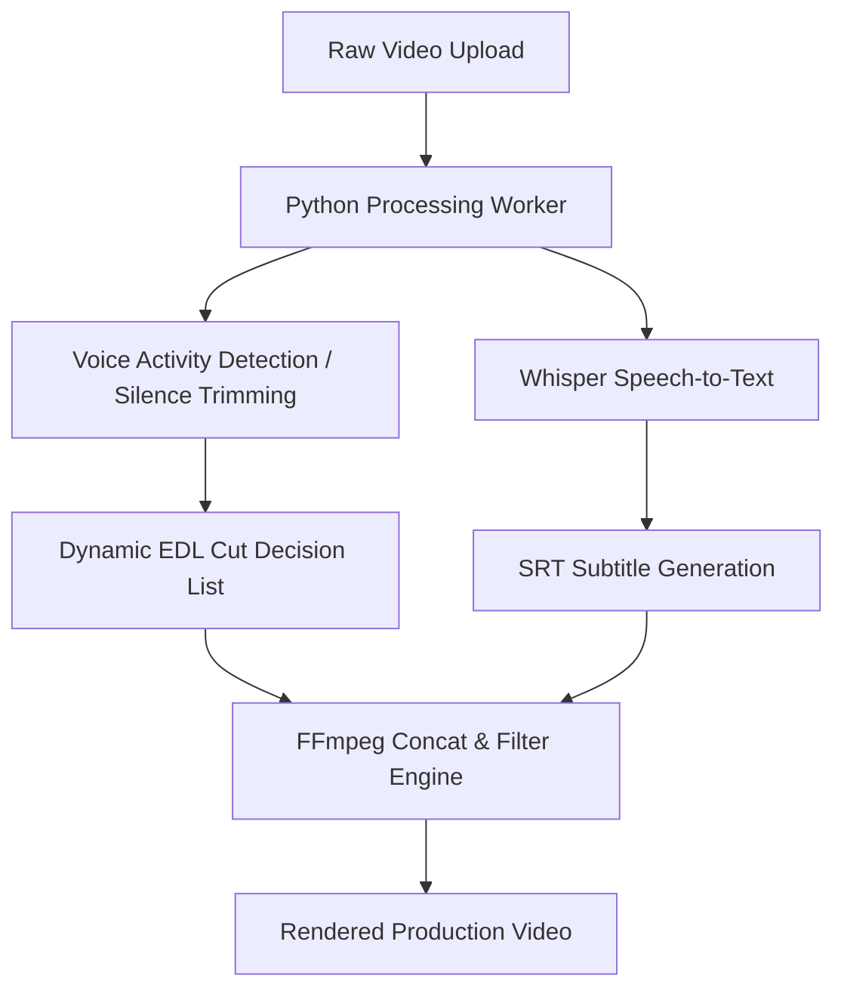

# Automated Video Post-Production and Audio Ducking Pipeline

> Distributed FFmpeg and Whisper media processing pipeline for automated rough cuts and subtitles.

[](https://github.com/sohailahmed-bsrh/video-editing-automation)
[](https://sohail.devsil.com/projects.html)
[](https://sohail.devsil.com)

---

## Overview

Video editors spend hours performing repetitive rough cuts, silence removal, subtitle timing, and audio leveling.

This project provides an end-to-end, reproducible implementation engineered to solve this challenge through verified data transformations, reliable algorithms, and production-ready architecture.

---

## Key Features

- Voice activity detection identifying and excising silence intervals from raw footage
- Whisper speech-to-text integration generating frame-synchronized subtitle captions
- Automated background audio ducking whenever speech frequencies are detected
- Asynchronous Python worker queue coordinated via Redis and BullMQ

---

## System Architecture



---

## Technology Stack

| Technology | Version / Spec | Role in Architecture |
| :--- | :--- | :--- |
| **FFmpeg & MoviePy** | `Latest` | Audio extraction, video filtering, and multithreaded rendering |
| **Whisper** | `Base/Medium` | Local automatic speech recognition and subtitle timestamping |
| **Node.js Backend** | `18+` | Job queue dispatching and file upload handling |
| **Python Worker** | `3.10+` | Mathematical silence detection and scene slicing |

---

## Repository Structure

```text
video-editing-automation/
|-- backend/
|   |-- python-worker/
|   |   |-- app/
|   |   |   |-- audio_analysis/
|   |   |   |-- scene_detection/
|   |   |   `-- transcription/
|   |   `-- main.py
|   |-- src/
|   |-- .env.example
|   `-- package.json
|-- .gitignore
`-- README.md
```

---

## Installation and Execution

### Prerequisites
- Node.js 18+ / Python 3.10+
- Git version control

### Setup Instructions
1. Clone the repository:
```bash
git clone https://github.com/sohailahmed-bsrh/video-editing-automation.git
cd video-editing-automation
```

2. Configure environment and dependencies:
```bash
cd backend
npm install
cp .env.example .env
npm run start
```

---

## Interface and Verification
The system produces verifiable execution logs, prediction matrices, or interactive browser interfaces depending on the target mode. Verify operation by executing the commands specified above or inspecting the demonstration notebooks.

---

## Author and Contact
Developed by **Sohail Ahmed** — Full Stack AI Engineer & Machine Learning Specialist.
- **Portfolio:** [sohail.devsil.com](https://sohail.devsil.com)
- **GitHub:** [@sohailahmed-bsrh](https://github.com/sohailahmed-bsrh)
- **Email:** [sohail.bsrh@gmail.com](mailto:sohail.bsrh@gmail.com)
