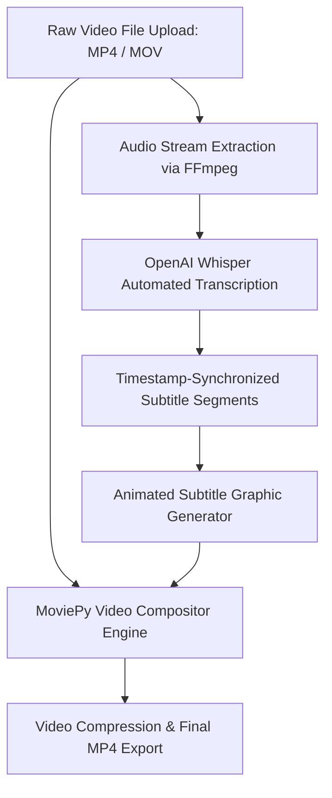

<div align="center">

<h1>Automated Video Processing & Subtitle Generation Pipeline</h1>


<p><strong>Programmatic Video Processing, Audio Extraction, Whisper Subtitling, and MoviePy Rendering</strong></p>

<p>
  <a href="https://skillicons.dev"></a>
</p>

<p>
  <a href="#overview">Overview</a> &bull;
  <a href="#system-architecture">Architecture</a> &bull;
  <a href="#visual-showcase-gallery">Visual Gallery</a> &bull;
  <a href="#core-capabilities">Capabilities</a> &bull;
  <a href="#installation--setup">Installation</a> &bull;
  <a href="#author--contact-information">Author</a>
</p>

</div>

---
## Overview

The Video Editing Automation framework automates repetitive video editing workflows. Given raw video files, the pipeline extracts audio tracks, performs speech transcription with OpenAI Whisper, generates synchronized animated subtitle overlays, applies video speed curves, and renders final composite videos using MoviePy and FFmpeg.

---

## Visual Showcase Gallery

<table width="100%" align="center">
  <tr>
    <td align="center"><b>Application Interface & Processing Hero</b><br><sub>Vite & React frontend interface communicating with FastAPI video processing backend.</sub></td>
  </tr>
  <tr>
    <td align="center"></td>
  </tr>
</table>

---

## System Architecture



---

## Technology Stack

| Layer | Technologies |
| :--- | :--- |
| Backend Server | FastAPI, Python 3.10+, Uvicorn |
| Media Processing | MoviePy, FFmpeg, Whisper |
| Frontend Interface | React, TypeScript, Vite, Tailwind CSS |

---

## Installation & Setup

```bash
# Clone the repository
git clone https://github.com/sohailahmed-bsrh/video-editing-automation.git
cd video-editing-automation

# Setup backend
cd backend
pip install -r requirements.txt
python main.py

# Setup frontend
cd ../frontend
npm install
npm run dev
```
---

## Author & Contact Information

<table width="100%" align="center">
  <tr>
    <td align="center" style="padding: 20px;">
      <h3>Sohail Ahmed</h3>
      <p><strong>Full-Stack Artificial Intelligence & Computer Vision Engineer</strong></p>
      <p>
        <a href="https://sohail.devsil.com"></a>
        <a href="https://github.com/sohailahmed-bsrh"></a>
        <a href="https://linkedin.com/in/sohail-ahmed-dev"></a>
        <a href="mailto:sohail.bsrh@gmail.com"></a>
      </p>
      <p><em>Available for technical roles in Artificial Intelligence, Computer Vision, and Full-Stack Engineering.</em></p>
      <hr style="border: 0; height: 1px; background: #30363d; margin: 15px 0;">
      <small>Repository: <code>sohailahmed-bsrh/video-editing-automation</code> &bull; Distributed under the MIT License.</small>
    </td>
  </tr>
</table>
